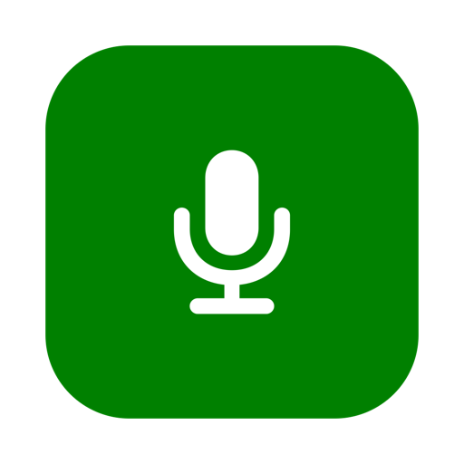
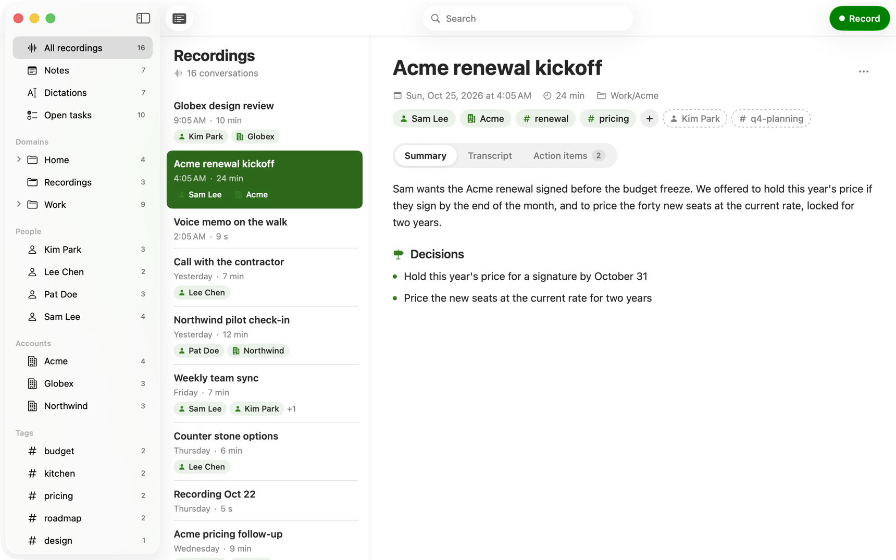

<p align="center"></p>

<h1 align="center">Glyph Jot</h1>

<p align="center"><i>Formerly Glyph Dictate, Glyph Record and Jot.</i></p>

<p align="center"><b>Hold Fn to jot. Click Record for meetings. One private library, on your Mac.</b></p>

<p align="center">
  <a href="https://github.com/fru-dev3/glyph-jot/releases/latest/download/Glyph-Jot.dmg">Download for Mac</a> ·
  <a href="https://glyph.fru.dev/jot">glyph.fru.dev/jot</a> ·
  <a href="#build-from-source">Build from source</a>
</p>

<p align="center"></p>

Glyph Jot is context capture for the Mac, and it never leaves your Mac. Hold Fn, talk, let go:
the words are typed where your cursor is. Click Record: a meeting or a long conversation is
recorded, transcribed and summarized. Notes, dictations and recordings live in one library,
filed by people, accounts and tags. Speech is Apple's on-device model; summaries and clean-up
use Apple Intelligence on the Mac. No account, no subscription, no cloud.

## What it does

| You do | Glyph Jot does |
|---|---|
| **Hold Fn**, talk, let go | Types it where your cursor is, in any app |
| **Fn + Shift** | Saves a note, types nothing |
| **Click Record** | Records the mic and the Mac's sound, then transcribes and summarizes on the Mac |
| **Hold Fn while recording** | Types where you are; the recording keeps going and that stretch stays out of its transcript and summary |
| **Fn + Shift while recording** | A note linked to that moment of the meeting |
| **Double-press Fn** | Hands-free until you press Fn again (Esc cancels) |
| **Fn + Control** | Command Mode: rewrites the selected text as you ask |
| **Fn + Option** | Asks your history: "what did I say about the launch date?" |
| Say **"fill the form, name ..., email ..."** | Fills every field of the form you're in |

- **One library.** Recordings, Notes and Dictations in the sidebar, with Open tasks from every
  meeting, and People, Accounts and tags that link them.
- **Typing never stops.** Dictation runs as its own process inside the app
  (`Contents/Helpers/Glyph Jot Dictation.app`). If the rest of the app crashes, you keep typing.
- **Cleans up while you talk**, learns your words, knows terminals ("dash dash no dash verify"
  is `--no-verify`), styles per kind of app, snippets.
- **Never loses a ramble** or a meeting: drafts are saved while you talk; a recording is closed
  safely even when you quit mid-meeting.

## Install

1. [Download Glyph-Jot.dmg](https://github.com/fru-dev3/glyph-jot/releases/latest/download/Glyph-Jot.dmg),
   open it and drag Jot to Applications. It's signed and notarized by Apple.
2. Open it. In **Settings > General > Permissions**, allow **Input Monitoring** (the Fn key),
   **Accessibility** (to type where you are) and **Microphone**. To record the other side of a
   call, allow **Screen & System Audio Recording** when you first record with the Mac's sound.
3. Hold Fn and talk, or click Record.

Updating from Glyph Dictate or Jot: it is the same app (`Jot.app`, same bundle id), so your
settings, words and permissions carry over.

**Needs** macOS 26 or later on Apple silicon. Summaries, clean-up of corrections, Command Mode,
asking your history and filling forms need Apple Intelligence; plain dictation and recording don't.

## Your words stay yours

- Speech, summaries and clean-up run on your Mac. Glyph Jot makes no network requests.
- Dictation writes no audio to disk; a recording is an `.m4a` in your library folder, yours.
- What you jot during a recording is marked in the conversation's `meta.json` (`jots`) and left
  out of its transcript and summary.
- Every dictation is a line of JSON in `~/Library/Application Support/Jot/dictations/`, with
  what was heard before clean-up. Notes are Markdown files. Recordings are plain folders
  (`docs/vault-format.md`).
- Choose any folder for notes and dictations in **Settings > General** (an Obsidian vault
  works) and any folder for recordings in **Settings > Record**.

## Build from source

Needs Xcode 26 and [XcodeGen](https://github.com/yonaskolb/XcodeGen) (`brew install xcodegen`).

```sh
git clone https://github.com/fru-dev3/glyph-jot.git && cd glyph-jot
./scripts/install.sh        # builds, installs to /Applications, opens it
./scripts/check.sh          # the key timing and text-rule checks, no mic needed
```

Set `DEVELOPMENT_TEAM` to your Apple team ID to sign with it, so macOS keeps the permissions
across rebuilds. `scripts/release.sh` builds releases (Developer ID, notarization, GitHub).

Code map: `Record/` is the app (library, recorder, settings, `Engine.swift` starts the
dictation engine); `Mac/` is the dictation engine (`FnKey.swift`, `Dictation.swift`,
`Polish.swift`, `Rules.swift`, `Pill.swift`, `EngineLink.swift`) and the settings both share;
`Mac/Link.swift` is the pipe between the two; `Packages/GlyphCore` records, transcribes,
summarizes and reads the library. Tests: the `JotMac` scheme and `swift test` in
`Packages/GlyphCore`. Live checks on a quiet Mac: `scripts/jot-while-recording-check.sh`,
`scripts/engine-isolation-check.sh`, and `scripts/engine-restart-check.sh` (safe any time).

## Versions

- **0.7.13** (2026-10-25): every capture says where it came from. A recording's `meta.json` keeps
  the Mac's name as `device`, shown beside its date and length; each dictation line keeps it too.
  The sidebar opens with the app's icon, name and "Personal context".
- **0.7.12** (2026-10-25): Jot captures, Glyph Studio files. The sidebar is All (a summary with
  Ask), Notes, Dictations, Recordings, then the Studio Domains, People, Products and Projects a
  capture is filed under, with counts; tags stay plain. Recordings and notes link to Studio ids;
  older People and Accounts move onto them at launch. No task list: action items read in a
  recording's summary. Tests never touch the installed app's settings or its dictation engine.
- **0.7.11** (2026-10-25): meeting notes keep only the action items the conversation states:
  no "None" or "No other action items mentioned" rows, no tasks the on-device model made up.
- **0.7.10** (2026-10-25): design pass. A person's or an account's page lists the notes that name
  them; a note links to the recording it was said in; Dictations keeps its filter and Ask in its
  header and shows a row's actions on hover; the library opens with the app (not at login).
- **0.7.9** (2026-10-25): Glyph Dictate and Glyph Record are one app, Glyph Jot. Click Record
  for a meeting, hold Fn to jot even while recording (kept out of the meeting's transcript),
  and find notes, dictations and recordings in one library with People, Accounts and tags.
  Dictation runs in its own process inside the app, so nothing else in it can stop your typing.
- **0.7.8** (2026-10-25): Jot is now Glyph Dictate, with the Glyph family icon. The app is still
  Jot.app with the same bundle id, so your settings, words and permissions carry over.
- **0.7.7** (2026-10-23): Jot checks it still reaches Apple's speech service every two minutes and after
  the Mac wakes, and reconnects while you aren't talking, so a dropped connection never meets a dictation.
- **0.7.6** (2026-10-23): no more restarting over and over when macOS drops its speech model; Jot fetches it
  once, waits for it, and says so on the pill if it isn't ready yet.
- **0.7.5** (2026-10-23): the pill shows on the screen you're typing on, not wherever the pointer is.
- **0.7.4** (2026-10-22): a new icon, a "j" that speaks.
- **0.7.3** (2026-10-21): a running timer always means you're heard. When Apple's speech service stops
  answering, Jot starts it again on everything you said so far (kept in memory only, never saved), and if it
  still won't answer, says so on the pill and relaunches itself.
- **0.7.2** (2026-10-21): with no text field (Finder, a page, the desktop) your words always stay on
  the clipboard; any folder can hold your notes, an Obsidian vault too.
- **0.7.1** (2026-10-21): forms fill from any browser page (also just opened, or with the address bar in focus), emails lowercase;
  "get commit" in a terminal is `git commit`; answers show their bold text.
- **0.7** (2026-10-21): fill a whole form by voice.
- **0.6**: ask your history (Fn + Option, or Ask on Home).
- **0.5**: never lose a ramble (drafts every 10 s, recovery after a crash), Undo Last
  Dictation and Use What I Said.
- **0.4**: terminals and editors: spoken symbols, "press enter" and "send it".
- **0.3**: learns from your fixes; misheard names matched to your Dictionary.
- **0.2**: the mic stays ready, with under a second of sound from before the key.
- **0.1** (2026-10-20): hold Fn to dictate anywhere, double-press for hands-free, thoughts,
  Command Mode, styles, Dictionary, Snippets, History, live time and words.

## License

MIT. Made by [fru.dev](https://fru.dev). If Glyph Jot saves you typing, a star helps others find it.
