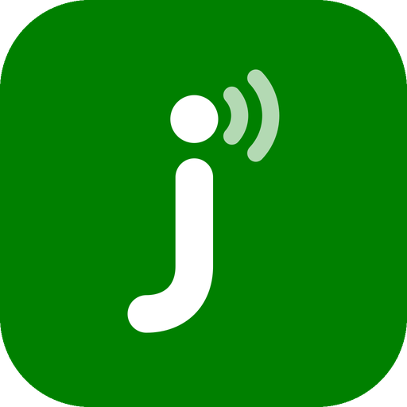
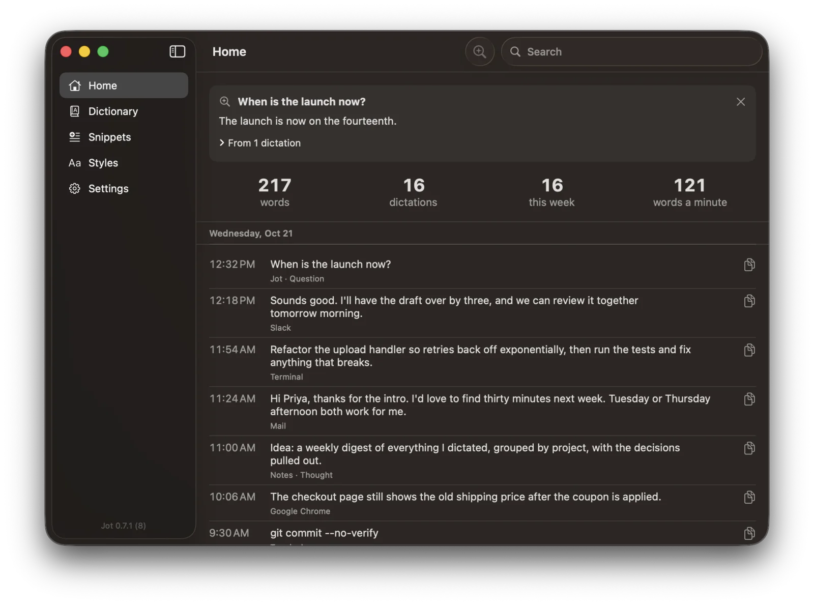

<p align="center"></p>

<h1 align="center">Jot</h1>

<p align="center"><b>Talk. It types. Free dictation for your Mac that never leaves it.</b></p>

<p align="center">
  <a href="https://github.com/fru-dev3/jot/releases/latest/download/Jot.dmg">Download for Mac</a> ·
  <a href="https://jot.fru.dev">jot.fru.dev</a> ·
  <a href="#build-from-source">Build from source</a>
</p>

<p align="center"></p>

Jot is voice dictation for the Mac that runs entirely on your Mac. Hold the Fn key, talk, let
go, and the words are typed where your cursor is: any app, any form, the terminal, an AI
coding agent's prompt. Speech recognition is Apple's on-device model; clean-up, Command Mode
and answers use Apple Intelligence on the Mac. No account, no subscription, no cloud, no audio
saved anywhere.

## What it does

| You do | Jot does |
|---|---|
| **Hold Fn**, talk, let go | Types it where your cursor is |
| **Double-press Fn** | Hands-free until you press Fn again (Esc cancels) |
| **Fn + Shift** | Saves a thought as a Markdown note, types nothing |
| **Fn + Control** | Command Mode: rewrites the selected text as you ask, or writes what you ask for |
| **Fn + Option** | Asks your history: "what did I say about the launch date?" |
| Say **"fill the form, name …, email …"** | Fills every field of the form you're in |
| End with **"press enter"** | Presses Return after typing ("send it" in a terminal) |
| **Control-Command-V / Z / R** | Paste the last dictation again / take it back out / swap it for exactly what you said |

- **Starts at once, never misses the first word.** The mic stays ready and keeps under a
  second of sound in memory, so a word said as the key goes down is still heard. (A setting;
  off, the mic turns on at the key.)
- **Cleans up while you talk.** Fillers go, "Tuesday, no wait, Wednesday" becomes Wednesday,
  spoken lists become lists, "new line" and "new paragraph" work. A long dictation is cleaned
  in the background as you go, so it lands about a second after you let go.
- **Learns your words.** Fix a word Jot typed and it remembers the spelling. Add names to the
  Dictionary; a name misheard by a letter or two is matched to it.
- **Knows terminals.** "dash dash no dash verify" is `--no-verify`, "scripts slash ship dot
  sh" is `scripts/ship.sh`.
- **Styles per kind of app.** Formal for email, casual for chat, your choice for each.
- **Snippets.** Say "my calendar link", get the link.
- **Never loses a ramble.** The words so far are saved every 10 seconds while you talk; if
  anything goes wrong they're on your clipboard, and after a crash they come back at launch.
- **History.** Every dictation, searchable, with your words per minute.
- **Live pill.** A small capsule shows your voice, the time and the word count while you talk.

## Install

1. [Download Jot.dmg](https://github.com/fru-dev3/jot/releases/latest/download/Jot.dmg),
   open it and drag Jot to Applications. It's signed and notarized by Apple.
2. Open Jot. In **Settings > Permissions**, allow **Input Monitoring** (to hear the Fn key),
   **Accessibility** (to type where you are) and **Microphone**.
3. Hold Fn and talk.

Jot sets **System Settings > Keyboard > "Press 🌐 key to"** to Do Nothing, so a double-press
doesn't open the emoji picker. Give Fn to one dictation app only. Prefer another key? Settings
offers Right Option, Right Command or Right Control.

**Needs** macOS 26 or later on Apple silicon. Clean-up of corrections, Command Mode, asking
your history and filling forms need Apple Intelligence turned on; plain dictation doesn't.

## Your words stay yours

- Speech and clean-up run on your Mac. Jot makes no network requests.
- No audio is ever written to disk. The ready mic holds under a second of sound in memory.
- Every dictation is kept as a line of JSON in
  `~/Library/Application Support/Jot/dictations/`, with what was heard before clean-up, so you
  can always get your exact words back. Thoughts are Markdown files in `~/Documents/Jot/Thoughts`.
- Jot never types into a password field, and puts your clipboard back after each paste.
  With no text field to type into, what you said stays on the clipboard to paste yourself.
- Keep them with your notes: choose any folder in **Settings > Where your words go** (an
  Obsidian vault works). Thoughts are saved in it as Markdown notes, and Jot keeps its own
  files (dictations, Dictionary) in a hidden `.jot/` folder there, so they sync with it.
  A [Prevail](https://prevail.sh) vault gets its own layout.

## Build from source

Needs Xcode 26 and [XcodeGen](https://github.com/yonaskolb/XcodeGen) (`brew install xcodegen`).

```sh
git clone https://github.com/fru-dev3/jot.git && cd jot
./scripts/install.sh        # builds, installs to /Applications, opens it
./scripts/check.sh          # the key timing and text-rule checks, no mic needed
```

Set `DEVELOPMENT_TEAM` to your Apple team ID to sign with it, so macOS keeps Jot's
permissions across rebuilds. `scripts/release.sh` is how releases are built: Developer ID
signing, notarization and a GitHub release.

Code map: `Mac/FnKey.swift` (the talk key), `Dictation.swift` (mic, speech, paste, log),
`Polish.swift` and `Rules.swift` (clean-up, styles, Dictionary), `Learner.swift` (learning
from fixes), `Ask.swift`, `FormFill.swift`, `Pill.swift`, `Settings.swift`, `History.swift`.

## Versions

- **0.7.1** (2026-10-21): forms fill from any browser page (also just opened, or with the address bar in focus), emails lowercase;
  "get commit" in a terminal is `git commit`; answers show their bold text.
- **0.7.3** (2026-10-21): a running timer always means you're heard. When Apple's speech service stops
  answering, Jot starts it again on everything you said so far (kept in memory only, never saved), and if it
  still won't answer, says so on the pill and relaunches itself.
- **0.7.2** (2026-10-21): with no text field (Finder, a page, the desktop) your words always stay on
  the clipboard; any folder can hold your notes, an Obsidian vault too.
- **0.7** (2026-10-21): fill a whole form by voice.
- **0.6**: ask your history (Fn + Option, or Ask on Home).
- **0.5**: never lose a ramble (drafts every 10 s, recovery after a crash), Undo Last
  Dictation and Use What I Said.
- **0.4**: terminals and editors: spoken symbols, "press enter" and "send it".
- **0.3**: learns from your fixes; misheard names matched to your Dictionary.
- **0.2**: the mic stays ready, with under a second of sound from before the key.
- **0.1** (2026-10-20): hold Fn to dictate anywhere, double-press for hands-free, thoughts,
  Command Mode, styles, Dictionary, Snippets, History, live time and words.

## License

MIT. Made by [fru.dev](https://fru.dev). If Jot saves you typing, a star helps others find it.
